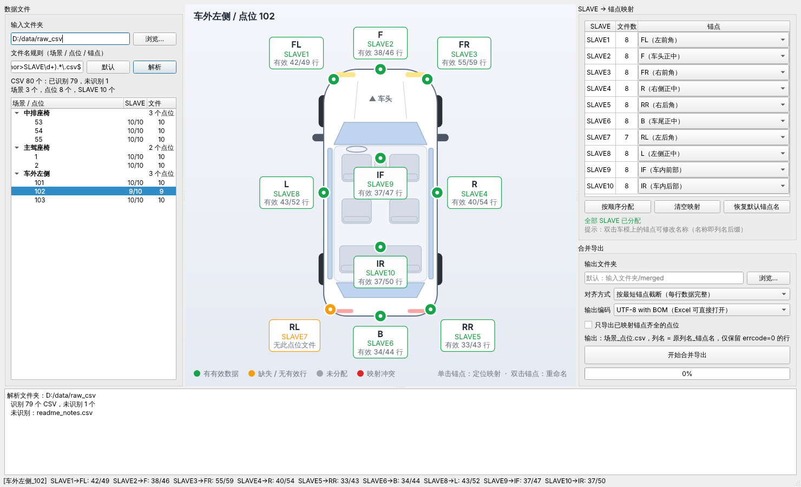
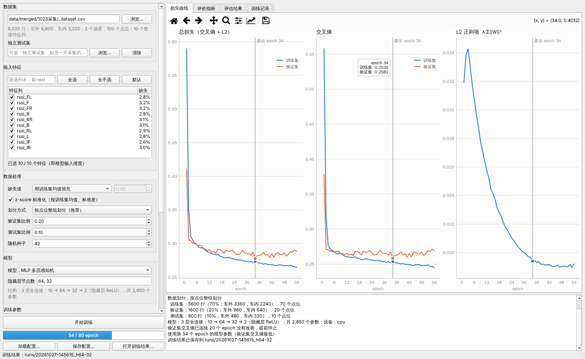
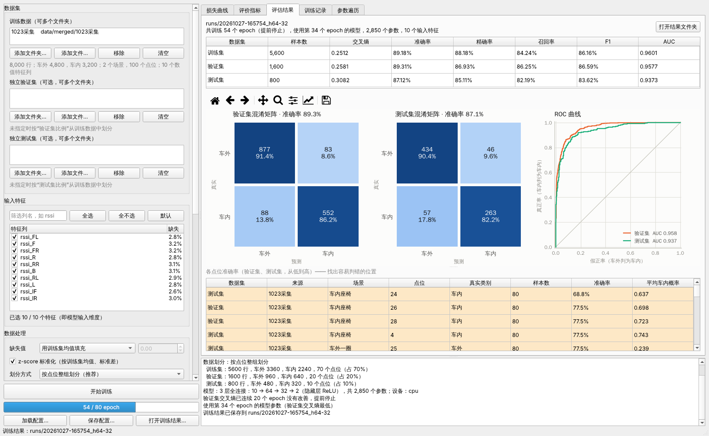
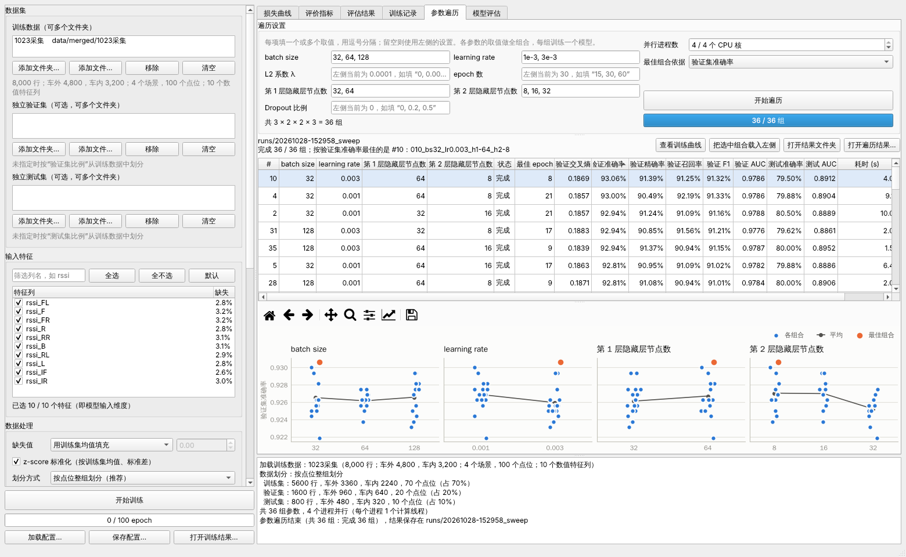

# CarInOut

钥匙车内外识别项目：

1. [数据集构建工具](#数据集构建工具)（`python main.py`）：把采集到的各锚点（SLAVE）CSV 按点位整合成带标签的数据集。
2. [模型训练平台](#模型训练平台)（`python train.py`）：在一个或多个数据集文件夹上训练车内 / 车外二分类模型（默认 3 层 MLP），
   实时显示损失曲线和评价指标；
   支持[参数遍历](#参数遍历)，多进程并行训练多组超参数并比较。

## 数据集构建工具



### 安装与启动

```bash
pip install -r requirements.txt
python main.py
```

### 输入

一个文件夹，内含若干 CSV（需包含 `ts` 和 `errcode` 列），文件名格式为 `场景-点位-[COM口][锚点] 时间.csv`，例如
`中间座椅+脚坑-68-[COM261][SLAVE4] 2026-10-23 15-44-12.743.csv`：

| 部分 | 示例 | 说明 |
| --- | --- | --- |
| 场景 | 中间座椅+脚坑 | 可包含 `-`、`_`、`+` 等 |
| 点位 | 68 | 不含 `_`、`-`、空格 |
| 锚点 ID | SLAVE4 | 取方括号里的内容（跳过 `[COMxxx]`），统一转为大写，如 `MASTER_MCU`、`SLVAE5` |
| 其余 | 2026-10-23 15-44-12.743 | 忽略 |

分隔符可以是 `-`、`_` 或空格。也兼容不带方括号的写法 `中排座椅_53_SLAVE2.csv`（锚点为 `SLAVE` + 数字）。
文件名规则是一个正则表达式，可在界面中修改，只需保留命名分组 `scene`、`point`、`anchor`。
无法识别的文件会列在日志中。

### 使用步骤

1. **选择输入文件夹** → 自动解析，左侧按 场景 / 点位 列出数据；缺少某些 SLAVE 的点位以橙色标出。
2. **SLAVE → 锚点映射**：右侧为每个锚点 ID 在下拉列表中选择车模上的锚点。
   - “按编号分配”：按 ID 末尾的编号对应锚点顺序（SLAVE1 → 左前角 …），`MASTER_MCU` 等没有编号的 ID 不分配。
   - 车模中央为俯视图（车头朝上）：车外 8 个锚点（四角 + 十字），车内 2 个锚点。
   - 默认名称：`FL` 左前角、`F` 车头正中、`FR` 右前角、`R` 右侧正中、`RR` 右后角、
     `B` 车尾正中、`RL` 左后角、`L` 左侧正中、`IF` 车内前部、`IR` 车内后部。
   - **双击车模上的锚点可重命名**，名称即合并后列名的后缀。
   - 两个 SLAVE 选了同一锚点会标红，必须修正后才能导出；未分配的 SLAVE 在导出时忽略。
   - 映射、锚点名称、文件名规则保存在 `config.json`，下次启动自动恢复。
3. **场景标签**：在左侧每个场景行的“标签”列选择 `1 车内` 或 `0 车外`，保存在 `config.json`。
4. **预览点位**：在左侧点击某个点位，车模上显示每个锚点 `errcode=0` 的有效行数 / 原始行数，
   标题栏显示该场景的标签和按 ts 对齐后的行数。
5. **合并导出**：选择输出位置，点击“开始合并导出”。结果放在输出位置下**与原始数据文件夹同名**的文件夹里，
   界面上会显示完整的导出路径。不选输出位置时，默认放在与原始数据文件夹同级的 `merged` 里：

   ```
   D:/data/1023采集/          ← 原始数据
   D:/data/merged/1023采集/   ← 导出结果（默认）
   ```

   目标文件夹已存在且不为空时会先确认：同名文件被覆盖，其他文件保留。

### 输出

- 每个 (场景, 点位) 一个文件：`场景_点位.csv`，例如 `中间座椅+脚坑_68.csv`。
- 只保留 `errcode` 为 0 的行（列名不区分大小写）。十进制 `0`、`0.0` 和十六进制 `0x00000000`、`0X0` 都视为 0，
  可以在同一批数据中混用；`0x0000001F` 等非 0 值被过滤。若某个文件的 errcode 全都无法识别，会报“格式无法识别”并给出示例值。
- **各锚点按 `ts` 列对齐**：首列为 `ts`，每一行是同一 ts 下所有锚点的特征，
  其余列名与原文件一致并加上 `_锚点名` 后缀，锚点按车模顺序排列，按 ts 升序：
  `ts, rssi_FL, …, errcode_FL, rssi_F, …`。
  - 数值型 ts 按数值比较（`100` 与 `100.0` 视为相同），否则按文本比较。
  - 同一锚点同一 ts 出现多次时，按出现顺序与其他锚点同 ts 的行一一配对。
  - “ts 对齐”可选：**只保留所有锚点都有数据的 ts**（默认），或**保留全部 ts**（缺数据的锚点补空）。
  - “ts 容差”默认 0（精确匹配）。如果各设备的 ts 不完全同步，可设一个容差（单位同 ts），
    此时以第一个锚点的 ts 为基准，其他锚点取相差不超过容差的最近一行，并额外保留各锚点的 `ts_锚点名` 列。
  - 若某个锚点的 ts 几乎与其他锚点都对不上，日志和预览中会提示可能不同步。
- **总表 `_dataset.csv`**（默认生成）：所有已标注场景的点位数据合在一起，末尾追加三列：
  `scene`（场景）、`point`（点位）、`label`（1 = 车内，0 = 车外）。未标注的场景不写入总表。
- 某个锚点在该点位缺少文件、读取失败或没有 errcode=0 的行时，视为该锚点缺失：
  - 默认仍导出该点位，只包含其余锚点的列（总表中补空），状态里注明是哪个锚点、什么原因；
  - 勾选“只导出已映射锚点齐全的点位”则跳过整个点位。预览点位时标题栏会提前提示。
- 同一点位同一 SLAVE 有多个文件时，按文件名顺序纵向拼接后再合并。
- 数值按原始文本写出，不改变格式；输入支持 UTF-8 / GBK 编码。
- `_summary.csv`：每个点位的标签、输出行数、状态以及各锚点的有效行 / 原始行数。

### 测试

```bash
python -m pytest
```

### 常见问题

- **启动时报 `OpenBLAS error: Memory allocation still failed after 10 retries`**：
  numpy 自带的 OpenBLAS 会按 CPU 核数为每个线程预留内存，核数多或内存紧张时分配失败。
  `main.py` 已在导入 numpy/pandas 前把 `OPENBLAS_NUM_THREADS` 等设为 1（本工具不做矩阵运算，不影响速度）。
  如果在其他脚本里直接 `import carinout`，请在导入 pandas 之前先设置这个环境变量。
  如果仍然报错，请检查是否为 32 位 Python：`python -c "import struct; print(struct.calcsize('P') * 8)"`，应输出 64。

## 模型训练平台





### 安装与启动

```bash
pip install -r requirements.txt
python train.py                                # 图形界面
python train.py --config configs/mlp.json      # 命令行训练（参数见 python train.py --help）
python train.py --dataset D:/data/merged/1023采集 --dataset D:/data/merged/1024采集 \
                --val-dataset D:/data/merged/1025采集        # 多个训练 / 验证文件夹
```

只用 CPU 训练时，可以先装 CPU 版 PyTorch，下载量小很多：
`pip install torch --index-url https://download.pytorch.org/whl/cpu`。

### 输入

数据集构建工具导出的总表 `_dataset.csv`（`ts, rssi_FL, …, errcode_FL, …, scene, point, label`），`label`：1 = 车内，0 = 车外。
训练数据、独立验证集、独立测试集都以**文件夹**为单位添加，每个文件夹里有一个 `_dataset.csv`
（即数据集构建工具的导出文件夹，如 `merged/1023采集/`），三者都可以有多个文件夹：

- 点“添加文件夹…”，或从资源管理器把一个或多个文件夹拖进列表；也可以“添加文件…”直接选 csv。
  选择上级文件夹（如 `merged/`）会添加其中所有含 `_dataset.csv` 的子文件夹。
- 同一个文件夹只能出现在训练数据、验证集、测试集其中之一；添加时已在其他列表中的文件夹会自动跳过并提示。

**训练数据**：多个文件夹的数据合在一起训练。

- 候选特征为**每个文件夹都有的**数值列；只在部分文件夹中出现的列不列入，日志中会提示。
- 未指定独立验证集 / 测试集时，从合并后的训练数据中按比例划分。按点位划分时，
  **不同文件夹中场景、点位都相同的数据视为同一位置**，分在同一个集合，避免同一位置既出现在训练集又出现在验证集。
- 评估结果中训练集（以及从中划分的验证集 / 测试集）也会按文件夹分别列出指标。

- **候选特征**：能解析为数值的列，排除 `ts`、`ts_*`、`errcode_*`、`scene`、`point`、`label`。
  默认勾选所有非常数的列；界面中可按列名筛选（如输入 `rssi` 后点“全选”），列表里显示每列的缺失比例。
**独立验证集 / 独立测试集**（可选）：例如用其他几天采集的数据做验证集、测试集，评估跨天的泛化能力。

- 多个文件夹的数据合在一起作为验证集（或测试集），用于选最佳 epoch、提前停止、比较参数组合；
  评估结果中还会按文件夹分别列出指标，看出每次采集的表现。
- 指定后，对应的“验证集比例” / “测试集比例”不生效，训练数据不再划出这部分。

### 模型与损失

- 默认模型 **MLP**：`输入 → Linear → ReLU → Linear → ReLU → Linear → 2 个 logits`，即 3 层全连接，
  隐藏层节点数默认 `64, 32`。填几个数字就是几层隐藏层（如 `128, 64, 32` 为 4 层全连接）。
- **Dropout**（可选）：比例大于 0 时，每个隐藏层的 ReLU 后加一层 Dropout，训练时按该比例随机把输出置 0，
  用于减轻过拟合；评估、推理时不生效。默认 0（不使用），可设 0 ~ 0.9，常用 0.1 ~ 0.5。
- **损失 = 交叉熵 + λ × Σ‖W‖²**：L2 项只对权重计算，不含偏置；两部分分别记录，在损失曲线中单独显示。
- 输出经 softmax 得到车内概率，≥ 0.5 判为车内；正类 = 车内。
- 训练结束后自动换回**验证集交叉熵最低**那个 epoch 的模型参数（没有验证集时按训练集总损失），评估和保存都用它。

### 可配置项

界面左侧、配置文件（JSON，界面中“保存配置…”可导出）和命令行三者对应：

| 配置项 | 配置文件 | 命令行 | 默认 |
| --- | --- | --- | --- |
| 训练数据 | `data.datasets`（文件夹列表） | `--dataset 文件夹`（可重复） | 无 |
| 输入特征 | `data.features`（空 = 全部非常数数值列） | `--features rssi_FL,rssi_F` | 全部 |
| 隐藏层节点数 | `model.params.hidden_sizes` | `--hidden 64,32` | `[64, 32]` |
| Dropout 比例 | `model.params.dropout` | `--dropout 0.2` | 0 |
| batch size | `train.batch_size` | `--batch-size` | 64 |
| learning rate | `train.learning_rate` | `--lr` | 0.001 |
| epoch 数 | `train.epochs` | `--epochs` | 100 |
| L2 系数 λ | `train.l2_lambda` | `--l2` | 0.0001 |
| 优化器 | `train.optimizer`：`adam` / `sgd`（momentum 0.9） | `--optimizer` | adam |
| 类别权重 | `train.class_weight`：`none` / `balanced` | `--class-weight` | none |
| 提前停止 | `train.early_stopping`：验证集交叉熵 N 个 epoch 无改善即停，0 不停 | `--early-stopping` | 0 |
| 缺失值 | `data.missing`：`drop` 丢弃行 / `mean` 训练集均值 / `constant` 固定值（`data.fill_value`） | `--missing` | drop |
| 标准化 | `data.standardize`：按训练集均值、标准差做 z-score | — | 开 |
| 划分方式 | `data.split`：`point` 按点位整组 / `row` 按行随机 | `--split` | point |
| 验证集 / 测试集比例 | `data.val_ratio` / `data.test_ratio` | `--val-ratio` / `--test-ratio` | 0.2 / 0.1 |
| 独立验证集 | `data.val_datasets`（文件夹列表） | `--val-dataset 文件夹`（可重复） | 无 |
| 独立测试集 | `data.test_datasets`（文件夹列表） | `--test-dataset 文件夹`（可重复） | 无 |
| 随机种子 | `train.seed`（数据划分和模型初始化） | `--seed` | 42 |
| 设备 | `train.device`：`auto` / `cpu` / `cuda` | `--device` | auto |

命令行参数会覆盖配置文件中的同名项，例如
`python train.py --config configs/mlp.json --hidden 128,64 --lr 3e-4 --name h128-64`。

**为什么默认按点位划分**：同一点位相邻时刻的样本几乎一样，按行随机划分时验证集里的点位训练集都“见过”，
指标会偏乐观。按 (场景, 点位) 整组划分（并按标签分层），验证 / 测试集衡量的是对**没见过的位置**的判断能力。

### 训练可视化

- **损失曲线**：总损失、交叉熵、L2 正则项三张图，训练集与验证集对比，竖线标出最佳 epoch。
  鼠标移到图上显示该 epoch 的数值；工具栏可缩放、平移、保存图片。
- **评价指标**：验证集的准确率、精确率、召回率、F1、AUC 随 epoch 的变化。
- **评估结果**：最佳模型在训练 / 验证 / 测试集上的指标表（独立验证集 / 测试集有多个文件夹时，逐个文件夹列出），
  验证集和测试集的混淆矩阵、ROC 曲线，以及**各点位的准确率**（含来源文件夹，从低到高，准确率低于 80% 标黄），
  方便找出容易判错的位置。
- **训练记录**：每个 epoch 的全部数值，最佳 epoch 一行高亮。
- **打开训练结果…**：重新查看以前某次训练的曲线和评估结果，并把它的配置载入左侧，方便对比、微调后再训练。

### 参数遍历



在“参数遍历”页为要比较的参数填写多个取值（逗号分隔），各参数的取值做全组合（网格搜索），每组训练一个模型：

| 可遍历的参数 | 示例 |
| --- | --- |
| batch size | `32, 64, 128` |
| learning rate | `1e-3, 3e-4` |
| L2 系数 λ | `1e-5, 1e-4, 1e-3` |
| epoch 数 | `50, 100` |
| 第 N 层隐藏层节点数（每层一项，层数与左侧“隐藏层节点数”一致） | 第 1 层 `32, 64, 128`，第 2 层 `16, 32` |
| Dropout 比例 | `0, 0.2, 0.5` |

留空的参数使用左侧的设置；数据集、特征、数据划分等其余设置也都取自左侧，所有组合共用同一份数据划分。
上例共 3 × 2 × 3 × 2 = 36 组。

- **并行**：每组参数在独立的**进程**中训练，“并行进程数”默认约为物理核数（逻辑核数的一半），最多 8 个。
  不用线程是因为 Python 的 GIL：小型 MLP 每个 batch 的耗时主要在 Python 代码上，多线程几乎无法同时运行，
  实测 4 个线程反而比串行还慢；4 个进程在 4 核机器上约快 2.7 倍。数据只读取、划分、标准化一次，再分发给各进程。
  每个进程约占几百 MB 到 1 GB 以上内存（装的是 GPU 版 PyTorch 时更多），内存紧张时调小进程数。
  “设备”为自动时，遍历在 CPU 上训练（多个进程同时用 GPU 会占用大量显存和内存）；需要 GPU 时把设备设为 CUDA。
- **进程意外退出**：某个训练进程意外退出（如内存不足被系统结束）时，只影响它正在训练的那一组：该组自动重试一次
  （表格显示“等待重试”），同时并行的进程数减一，其他组照常训练。原因会写在日志和该组的“状态”中。
- **进度**：表格中每组一行，显示“训练中 12/100”等状态；每完成一组就更新指标、图表和 `results.csv`。
- **停止**：正在训练的组合在当前 batch 后停止并保存结果（状态“已停止”），尚未开始的组合不再运行（“未运行”）。
  最多等待 30 秒，仍未结束的进程会被强制结束。
- **比较**：按“最佳组合依据”（验证集准确率 / F1 / AUC / 交叉熵）排序，最佳一行高亮；点击表头可按任一列排序。
  下方图表每个参数一张：横轴为取值，点为各组合，折线为同一取值的平均，橙色为最佳组合，可以看出每个参数的影响。
- **查看与采用**：双击一行（或“查看训练曲线”）在前几页显示该组合的损失曲线和评估结果；
  “把选中组合载入左侧”用这组参数覆盖左侧配置，可继续微调或单独训练。
- “打开训练结果…”或“打开遍历结果…”可以重新查看以前的遍历。

命令行：

```bash
python train.py --config configs/mlp.json --workers 8 \
    --sweep bs=32,64,128 --sweep lr=1e-3,3e-4 --sweep hidden1=32,64,128 --sweep hidden2=16,32 \
    --sweep dropout=0,0.2
```

`--sweep` 可用的参数名：`bs`（batch size）、`lr`、`l2`、`epochs`、`hidden1` / `hidden2` …（第 N 层隐藏层节点数）、`dropout`；
`--rank-by` 选择排序指标（`val_accuracy` / `val_f1` / `val_auc` / `val_ce`）。按 Ctrl+C 停止，已训练的结果会保存。

结果保存在 `runs/时间_sweep/`：`results.csv`（每组一行：参数取值、状态、最佳 epoch、训练 / 验证 / 测试集指标、耗时）、
`sweep.json`（基础配置与遍历取值），以及每组一个普通的训练结果文件夹，如 `007_bs32_lr0.003_h1-32_h2-8/`。

### 训练结果

每次训练在保存位置（默认 `runs/`）下新建一个文件夹 `时间_名称`：

| 文件 | 内容 |
| --- | --- |
| `config.json` | 本次完整配置（`features` 为实际使用的特征，训练数据 / 验证集 / 测试集为实际使用的文件），`python train.py --config` 可直接复现 |
| `history.csv` | 每个 epoch 的损失与验证集指标 |
| `metrics.json` | 最佳模型在各数据集上的指标、混淆矩阵 `[[TN, FP], [FN, TP]]`、按文件夹的指标（`sources`），以及数据划分说明 |
| `predictions.csv` | 每个样本的 `split, source`（来自哪个文件夹）`, ts, scene, point, label, prob`（车内概率）`, pred` |
| `model.pt` | 模型参数 + 特征列表 + 缺失值填充值 + 标准化参数 |
| `loss.png` / `metrics.png` / `evaluation.png` | 图表 |

用训练好的模型推理（会按训练时的方式选特征、填充缺失值、标准化）：

```python
from carinout.training.data import load_table
from carinout.training.runs import Predictor

predictor = Predictor.load("runs/20261027-153012_mlp")    # 结果文件夹或其中的 model.pt
prob = predictor.predict_proba(load_table("D:/data/merged/1027采集/_dataset.csv"))  # 车内概率
```

### 更换模型（模块化）

```
carinout/training/
  config.py    配置（JSON 读写与校验）
  data.py      读取总表、选特征、缺失值、划分、标准化
  models/      模型注册表：base.py（ModelSpec / ParamSpec）、mlp.py
  losses.py    交叉熵 + L2
  trainer.py   训练循环、最佳 epoch、提前停止、评估
  metrics.py   准确率 / 精确率 / 召回率 / F1 / AUC / ROC / 混淆矩阵
  plots.py     图表（界面与 PNG 共用）
  runs.py      训练结果保存 / 读取，Predictor 推理
  sweep.py     参数遍历：网格组合、多进程并行训练、结果汇总
  cli.py       命令行
carinout/gui/train_window.py, train_charts.py, sweep_panel.py   界面
```

模型只需满足：`nn.Module`，输入 `(batch, 特征数)`，输出 `(batch, 2)` 的 logits。新增一种模型：
在 `carinout/training/models/` 下新建模块，声明它的超参数，并在 `models/__init__.py` 的 `_BUILTIN` 中加入。
界面会自动出现该模型和对应的参数输入框，它的数值参数也会自动出现在参数遍历页；
数据处理、训练、评估、可视化、保存与推理都不需要修改。

```python
# carinout/training/models/resmlp.py（示例）
from torch import nn
from .base import KIND_FLOAT, KIND_INT, ModelSpec, ParamSpec

class ResMLP(nn.Module):
    def __init__(self, in_features, num_classes, width, blocks, dropout):
        ...

SPEC = ModelSpec(
    name="resmlp",
    label="残差 MLP",
    description="带残差连接和 Dropout 的全连接网络",
    params=(
        ParamSpec("width", "宽度", KIND_INT, 64, minimum=1),
        ParamSpec("blocks", "残差块数", KIND_INT, 2, minimum=1),
        ParamSpec("dropout", "Dropout", KIND_FLOAT, 0.1, minimum=0, maximum=0.9),
    ),
    factory=lambda in_features, num_classes, **p: ResMLP(in_features, num_classes, **p),
)
```

### 常见问题

- **图表中的中文显示为方框**：matplotlib 会自动选用系统里的中文字体（微软雅黑、黑体、苹方、Noto Sans CJK、文泉驿等），
  都没有时请安装其中一种。
- **Windows 上报 `OSError: [WinError 1114] … c10.dll`**：PyTorch 要在 PySide6 之前导入，`train.py` 已经这样处理；
  在自己的脚本里同时用到两者时也请先 `import torch`。
- **训练集准确率很高、验证集明显偏低**：模型记住了训练点位。可以加大 L2 系数、加 Dropout、减少隐藏层节点数、
  开启提前停止，或者补充更多点位的数据。
- **参数遍历中出现“训练进程意外退出”或“训练进程启动失败”**：多数是内存不足——每个进程都要加载一份 PyTorch。
  先查看日志中的具体原因，然后：
  - 调小“并行进程数”；
  - Windows 上若是 `WinError 1455`（页面文件太小）：GPU 版 PyTorch 的 CUDA 库很大，多个进程同时加载会耗尽虚拟内存。
    小模型用不到 GPU，建议改装 CPU 版：`pip uninstall torch`，再
    `pip install torch --index-url https://download.pytorch.org/whl/cpu`；或者在系统设置中增大虚拟内存。
